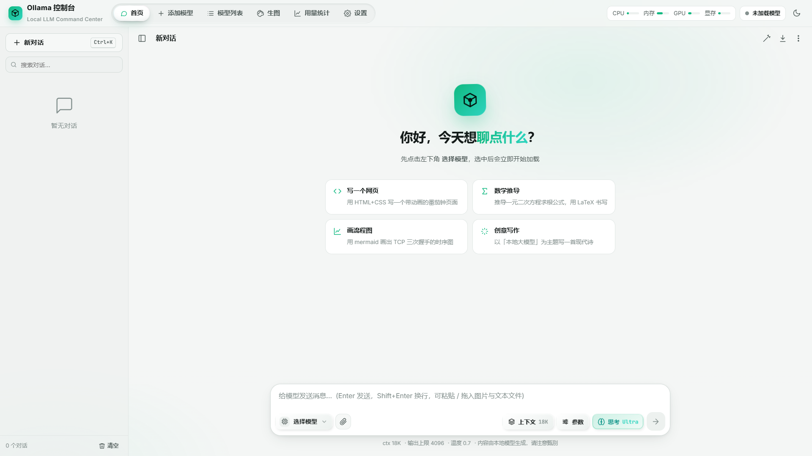

**简体中文** | [English](README_EN.md)

# Ollama 控制台（Ollama Console）



> 使每个人都可以更快的部署本地的模型（包括手动导入GGUF）。
> 实现真正的开箱即用，几乎无任何学习成本，无需配置繁杂的参数，只要把这篇README.md读完，！
> 你就可以开始使用真正部署在你本地的模型了！并完成任何任务(取决于你的模型)。

支持的两种界面语言：**中文**（`app-cn.py`）与 **English**（`app-en.py`），可在设置中随时切换。
直接开始 - [快速开始](#快速开始)

---

## 目录

- [特性总览](#特性总览)
- [环境要求](#环境要求)
- [快速开始](#快速开始)
- [界面语言（中文 / English）](#界面语言中文--english)
- [目录结构](#目录结构)
- [六大功能区](#六大功能区)
- [命令行参数](#命令行参数)
- [HTTP API](#http-api)
- [数据、存储与备份](#数据存储与备份)
- [命令行仪表盘](#命令行仪表盘)
- [常见问题](#常见问题)
- [开发与测试](#开发与测试)
- [设计说明](#设计说明)
- [版本](#版本)
- [联系方式](#联系方式)
- [English Quick Start](#english-quick-start)

---

## 特性总览

| 能力 | 说明 | 状态 |
| --- | --- | --- |
| 对话 | 流式输出、思考过程折叠展示、随时停止、HTML 预览 / 数学公式 / Mermaid / 代码高亮 | 已实现 |
| HTML 预览 | 可选择「代码」或「预览」；预览带移动端 / 平板 / 桌面宽度切换 | 已实现 |
| 模型分区 | 任意数量的分区，每个分区可指向任意磁盘的任意文件夹，分区名可自定义 | 已实现 |
| 模型导入 | 既可从 Ollama 官方库下载（自动执行 `ollama run` 到指定目录），也可直接导入本地 GGUF 并解析元数据 | 已实现 |
| 模型备注 | 每个模型可写备注名，列表与选择器优先显示备注 | 已实现 |
| MTP 推测解码 | 识别 GGUF 中的 `nextn.* / mtp.*` 张量与 `nextn_predict_layers`，对支持的模型自动以 draft-mtp 模式运行 | 已实现 |
| 生图 | 文生图 / 图生图（stable-diffusion.cpp），进度、取消、队列、历史与参考图 | 已实现 |
| 用量统计 | 日 / 7 天 / 30 天 / 全部；按模型、按小时、趋势、热力图、分布、散点与明细表 | 已实现 |
| 对外 API | 独立端口，同时提供 OpenAI 兼容接口（`/v1`）与 Ollama 原生接口代理（`/api`），支持 API Key、CORS、局域网 | 已实现 |
| 命令行仪表盘 | 启动动画 + 实时仪表盘（系统 / 当前模型 / 引擎 / 用量与任务 / 实时日志） | 已实现 |
| 界面语言 | 中文 / English 双语，可由启动入口决定默认值，也可在设置中切换 | 已实现 |
| 数据备份 | 启动自动备份、手动备份 / 恢复、设置导入导出 | 已实现 |
| 本地优先 | 依赖、缓存、日志、数据库、模型全部留在项目目录内，不上传任何数据 | 已实现 |

---

## 环境要求

| 项目 | 要求 |
| --- | --- |
| 操作系统 | Windows 10 / 11（当前针对 Windows 实现，含一次性的环境沙箱化） |
| Python | 3.10 或更高（本项目在 3.12 / 3.13 上运行） |
| Ollama | 需要本机安装（实测 v0.40.4 或更新版本） |
| GPU | 可选。NVIDIA 显卡可用性由 `nvidia-ml-py` 探测；无独显时自动回退到 CPU 推理 |
| 磁盘 | 建议预留足够空间存放 GGUF / 生图模型（单个模型可达数 GB 到数十 GB） |

Python 依赖只有 5 个（见 `requirements.txt`）：

```
flask==3.1.3
requests==2.34.2
rich==15.0.0
psutil==7.2.2
nvidia-ml-py==13.615.71
```

**首次运行会自动把这些依赖安装到 `runtime/pylib`，不会污染系统 Python。**

---

## 快速开始

1. 确认本机已安装 Ollama（`ollama --version` 能正常输出）。
2. 在项目根目录执行：

```powershell
# 中文界面（默认）
python app-cn.py

# 英文界面
python app-en.py

# 不自动打开浏览器（服务器 / 远程桌面场景）
python APP-NO.py

# 临时换端口、纯日志模式
python app-cn.py --port 9000 --plain
```

3. 浏览器会自动打开 `http://127.0.0.1:8848`（端口可在 设置 → 界面服务 中修改）。
4. 在「添加模型」中创建分区并下载 / 导入模型，回到「首页」在输入框左下角选择模型即可开始对话。

> 首次启动会播放一段约 8 秒的命令行启动动画（可在 设置 → 外观 → 命令行开机动画 中改为「快速 / 关闭」）。

---

## 界面语言（中文 / English）

语言由**启动入口**与**设置项**共同决定，规则如下：

| `ui.language` 设置 | 实际语言 |
| --- | --- |
| `跟随启动器`（默认） | 由启动入口决定：`app-cn.py` → 中文，`app-en.py` → 英文 |
| `中文` | 始终中文 |
| `English` | 始终英文 |

- 命令行启动动画与实时仪表盘的语言**始终跟随启动入口**（`app-cn.py` / `app-en.py`，也可用 `--lang` 临时覆盖）。
- 浏览器界面可在 **设置 → 外观 → 界面语言** 中随时切换，切换立即生效、无需重启。
- **后端产生的文案**（运行日志、接口错误提示、模型加载阶段名、任务消息、Markdown 导出正文）跟随**界面语言**：
  前端会在每个请求上带 `X-Lang` 请求头（事件流用 `?lang=`），后端据此返回对应语言的文本。
  因此即使启动入口是英文，把界面切回中文后，错误提示与日志也会是中文，反之亦然。
- 用 `app-en.py` 启动时，服务端会把语言注入页面，首帧即为英文，不会先闪一下中文。

---

## 目录结构

```
ollama最终兵器/
├── app-cn.py              # 中文启动入口
├── app-en.py              # 英文启动入口
├── APP-NO.py              # 不自动打开浏览器的启动入口
├── requirements.txt
├── backend/
│   ├── launcher.py        # 启动流程（环境沙箱化 + 服务编排 + 启动动画）
│   ├── i18n.py            # 命令行 / 服务端中英文案
│   ├── console.py         # 启动动画 + 实时仪表盘（rich）
│   ├── context.py         # 应用上下文装配
│   ├── core/              # 配置、数据库、GGUF 解析、Ollama 客户端、事件总线
│   ├── routes/            # Flask 蓝图（对话 / 模型 / 统计 / 生图 / 杂项）
│   ├── services/          # 引擎、加载器、对话、生图、任务、注册表、用量、系统监测
│   └── priv/              # 提权相关（Shizuku / 无障碍等可选能力）
├── web/                   # 前端（无构建步骤的原生 ES 模块）
│   ├── index.html
│   └── static/
│       ├── css/           # 令牌、外壳、对话、页面、生图
│       ├── js/core/       # API、状态、UI 工具、图标、Markdown、i18n 引擎
│       ├── js/pages/      # 六大页面模块
│       ├── js/i18n/       # 英文词表（按模块拆分）
│       └── vendor/        # 本地化第三方库（ECharts / KaTeX / highlight.js / mermaid / DOMPurify）
├── data/                  # 数据库、设置镜像、生图产物、备份
├── runtime/               # 依赖、日志、临时文件、Ollama 运行目录、sd 可执行文件
└── tests/                 # 端到端与界面实测脚本
```

---

## 六大功能区

### 1. 首页（对话）

- 输入框区域自左向右：**选择模型** → 附件 → 上下文 → 参数 → 思考 → 发送 / 停止。
- 选择模型后**立即开始加载**，按钮下方有实时进度条；加载中切换模型会先卸载再加载新模型；对话进行中切换模型则等输出结束或手动停止后再重载。
- 深度思考支持 8 档：`关闭 / MINI / LOW / MEDIUM / HIGH / X-HIGH / MAX / ULTRA`，每档可设置思考 token 预算（0 表示不限制）。
- 模型输出结束后追加一行统计：输入 tokens、输出 tokens、生成速度、推理耗时、首 Token 耗时。
- 左侧历史列表支持折叠、搜索、置顶、重命名、删除与清空。
- 支持粘贴 / 拖入图片与文本文件；HTML 可切换「代码 / 预览」，数学公式、Mermaid 与代码高亮均本地渲染。

### 2. 添加模型

- 分区管理：分区可指向任意磁盘的任意文件夹，名称自定义，互不影响。
- 两种导入方式：从 Ollama 官方库下载（输入模型 ID，自动执行 `ollama run …` 到目标目录），或直接导入本地 GGUF。
- 导入前会解析 GGUF 元数据：架构、参数量、量化类型、最大上下文、MTP 头等。
- 底部提供任务队列，可查看下载 / 导入进度与阶段。

### 3. 模型列表

表格列：备注名称、模型 ID、类别、添加时间、参数量、模型大小、最大上下文、（MTP 标记）。
支持按分区筛选、按关键字搜索、点击备注即时编辑、查看模型详情（元数据 / 默认参数 / 模板 / 许可证 / 笔记）与删除。

### 4. 生图

- 基于 stable-diffusion.cpp：文生图与图生图，可调宽度 / 高度 / 步数 / CFG / 采样器 / 调度器 / 种子 / batch 等全套参数，另有「高级参数」折叠区。
- 实时进度（步数、每步耗时、剩余时间、队列），可随时取消。
- 历史记录可预览、下载、清空；支持保留天数与自动清理。

### 5. 用量统计

- 区间：今日 / 7 天 / 30 天 / 全部。
- 图表：用量趋势（堆叠输入 / 输出 / 思考）、模型排行、按小时热力图、来源与状态分布、速度-耗时散点。
- 明细表：按模型、按次调用，含失败数与首 Token 耗时。
- 所有对话与 API 调用（`source=api`）都会计入，可在 设置 → API 服务 中关闭记录。

### 6. 设置

14 个分区：外观、对话、深度思考、默认参数、上下文、Ollama 引擎、生图、API 服务、界面服务、提示词预设、数据与备份、运行日志、快捷键、关于。

- **外观**：主题（深色 / 浅色 / 跟随系统）、界面语言、强调色、字号、消息区宽度、界面动画、命令行开机动画、动画速度、历史侧栏。
- **引擎**：Ollama 路径、起始端口、keep-alive、Flash Attention、KV Cache 精度、并行数、加载超时、推测解码类型等。
- **API 服务**：开关、端口、局域网监听、API Key、CORS、是否计入用量。
- **提示词预设**：内置的通用助手 / 代码专家 / 翻译官 / 前端设计师 / 数学老师等，可自行增删改。

---

## 命令行参数

所有入口共用同一套参数（在 `backend/launcher.py` 中定义）：

| 参数 | 说明 |
| --- | --- |
| `--no-browser` | 启动后不自动打开浏览器 |
| `--port N` | 临时指定界面端口（默认读取设置，8848） |
| `--plain` | 纯日志输出，不进入全屏仪表盘 |
| `--lang zh\|en` | 临时覆盖本次运行的语言（命令行与浏览器默认语言） |

---

## HTTP API

对内网 / 本机开放，默认端口 `8849`（可在设置中修改或关闭）。

- `GET /` —— 服务描述
- `GET /v1/models`、`POST /v1/chat/completions` —— OpenAI 兼容
- `/api/*` —— Ollama 原生接口代理
- 模型名可写 `模型ID`，也可写 `分区名/模型ID`
- 支持 Bearer Key 鉴权、CORS、局域网监听

---

## 数据、存储与备份

| 路径 | 内容 |
| --- | --- |
| `data/app.db` | **唯一真源**：设置、对话、模型登记、用量、任务（SQLite + WAL） |
| `data/settings.json` | 设置的可读镜像，便于查看与手工备份（真源仍是数据库） |
| `data/images/` | 生图产物（按任务 ID 存放，含预览图） |
| `data/backups/auto-*/` | 启动时的自动备份 |
| `runtime/pylib/` | 项目内 Python 依赖 |
| `runtime/logs/` | 运行日志（含 `errors.log`） |
| `runtime/home/.ollama/` | 项目隔离的 Ollama 运行目录 |
| `runtime/sdcpp/` | stable-diffusion.cpp 可执行文件与 CUDA 运行库 |

所有内容都在项目文件夹内，删除整个目录即完成彻底清理（模型目录若指向外部磁盘需另行清理）。

---

## 命令行仪表盘

启动时会播放一段分阶段动画：内核引导 → Logo 显影 → 版本徽章 → 系统自检 → 硬件扫描 → 充能 → READY 爆破，随后无缝切换到实时仪表盘：

- **系统**：CPU / 内存 / GPU / 显存（含显卡型号与温度）
- **当前模型**：状态、进度、阶段、上下文、显存占用、加载耗时
- **引擎**：各分区引擎端口与状态、API 服务地址
- **用量与任务**：今日 / 累计用量、平均速度、首 Token、进行中的任务
- **实时日志**：滚动日志，`Ctrl+C` 退出（关闭浏览器不影响后台运行）

不支持全屏动画的终端（哑终端 / 管道 / 小窗口 / `--plain`）会自动降级为逐行简洁模式。

---

## 常见问题

**Q：端口被占用怎么办？**
启动时会自动在首选端口之后寻找可用端口；也可用 `--port N` 指定，或在 设置 → 界面服务 中修改。

**Q：界面打不开 / 白屏？**
确认命令行窗口仍在运行（关闭该窗口会终止后台）；其次确认没有被杀软拦截端口监听。

**Q：模型列表看不到刚下载的模型？**
在「模型列表」点「重新扫描」；若模型放在自定义分区，确认分区路径正确。

**Q：显示「MTP —」是什么意思？**
表示该 GGUF 没有 `nextn.* / mtp.*` 张量或 `nextn_predict_layers` 声明，引擎无法启用推测解码——这是文件本身的限制，标记是准确的。

**Q：怎么完全重置？**
设置页有「全部恢复默认」；数据层面删除 `data/app.db` 会清空对话 / 用量 / 模型登记（请先备份）。

**Q：能多开吗？**
可以，但需要不同的界面端口、API 端口与引擎起始端口，且共用同一个数据目录会互相覆盖，建议复制一份项目目录。

---

## 开发与测试

`tests/` 下是实测脚本，多数需要先启动 `app-cn.py`：

| 脚本 | 用途 |
| --- | --- |
| `smoke_api.py` | 后端接口冒烟 |
| `regression.py` | 主流程回归 |
| `ui_flow.py` | 界面交互（悬浮窗、模型切换、发送 / 停止、HTML 预览、公式） |
| `console_pty.py` / `console_dumb.py` | 命令行界面与降级路径 |
| `launch_real.py` | 按真实方式启动并自检 |
| `mtp_*.py` | MTP 推测解码的 A/B 与端到端验证 |
| `settings_persist.py` | 设置持久化 |
| `e2e_image.py` / `probe_*.py` | 生图链路 |

前端是**无构建步骤**的原生 ES 模块，改完直接刷新即可生效（静态资源强制不缓存）。

---

## 设计说明

- **界面**：深色优先，避免蓝紫 / 金色；顶部导航使用自绘的液态玻璃滑块（弹簧驱动、速度形变、边缘折射高光），输入区的选择模型 / 上下文 / 参数 / 思考按钮使用 3D 拟态 + 弹性按压。
- **双语实现（前端）**：源码始终写中文原文，英文模式下由运行时的 i18n 层在 DOM 层替换文本与提示属性，词表放在 `web/static/js/i18n/`。中文模式零开销、可随时切回，也不会因为翻译改动破坏既有交互逻辑。
- **双语实现（后端）**：同样以中文原文为键，`backend/i18n.py` 提供 `T()`，词表拆到 `backend/i18n_parts/*.py` 按模块维护。命令行文案用启动语言；HTTP 请求的文案由 `X-Lang` 决定，从而与浏览器界面保持一致。
- **语言无关的内容**：分区名、模型备注名、磁盘路径、对话标题、自定义提示词预设、GGUF 字段值等属于用户数据，任何语言下都保持原样。
- **配置**：SQLite 为唯一真源，`settings.json` 只是镜像，避免手工编辑与程序状态不一致。

---

## 版本

版本历史与每次变更详见 [CHANGELOG.md](CHANGELOG.md)。
当前版本为 v1.1.31b — 集中修复 22 项缺陷（模型同步、GGUF 导入、接口鉴权、对话参数、生图与统计），并补修上下文浮窗被模型上限钳制时打不开、预设档位超限的问题。

---

## 联系方式

- **邮箱**：dvdvjvb@163.com

有问题、建议或想反馈 Bug，欢迎邮件联系。

---

## 致谢

- Ollama官方仓库：[https://github.com/ollama/ollama)